<p align="center">
  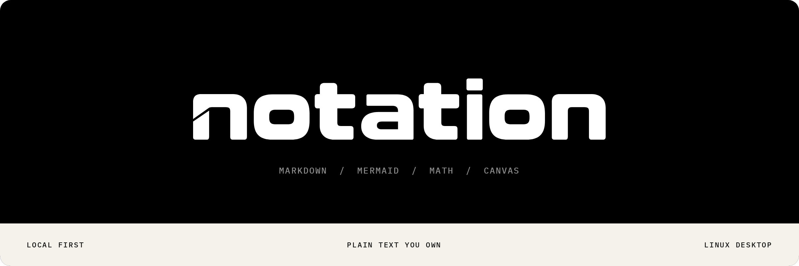
</p>

<p align="center">
  A local-first editor for Markdown, Mermaid, math and Canvas.<br>
  Plain-text files on your own disk, in a native Linux window. No account, no sync service.
</p>

<p align="center">
  <a href="#desktop-application">Install</a>
  &nbsp;&middot;&nbsp;
  <a href="docs/user-guide.md">User guide</a>
  &nbsp;&middot;&nbsp;
  <a href="docs/examples.md">Examples</a>
  &nbsp;&middot;&nbsp;
  <a href="#development">Development</a>
  &nbsp;&middot;&nbsp;
  <a href="#brand">Brand</a>
</p>

<p align="center">
  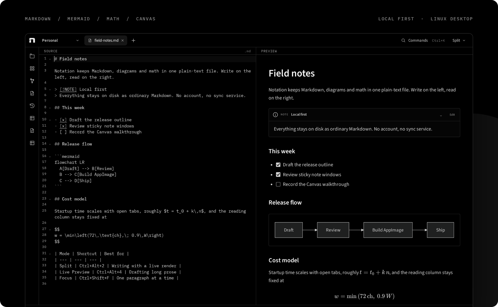
</p>

Built with Svelte 5, CodeMirror 6 and a Rust/Tauri 2 backend; canvas boards use [Svelte Flow](https://svelteflow.dev). It ships as a standalone Linux AppImage, with a browser mode for development.

| Area | Highlights |
| --- | --- |
| **Write** | Source, Split, Preview and Live Preview modes; tasks, callouts, tables, folding, wiki links and properties |
| **Diagram** | Mermaid and Graphviz render inline; math is Typst first with LaTeX (KaTeX) as the fallback, both bundled, with no network |
| **Organize** | Workspaces, an explorer, a note graph, history, templates and Canvas boards |
| **Export** | HTML, self-contained webpages, PDF, DOCX and slides, with Pandoc and Typst bundled in the AppImage |
| **Desktop** | Native sticky note windows, a Git view for the active file, and an MCP connection for agents |

## A closer look

<table>
  <tr>
    <td width="50%" valign="top">
      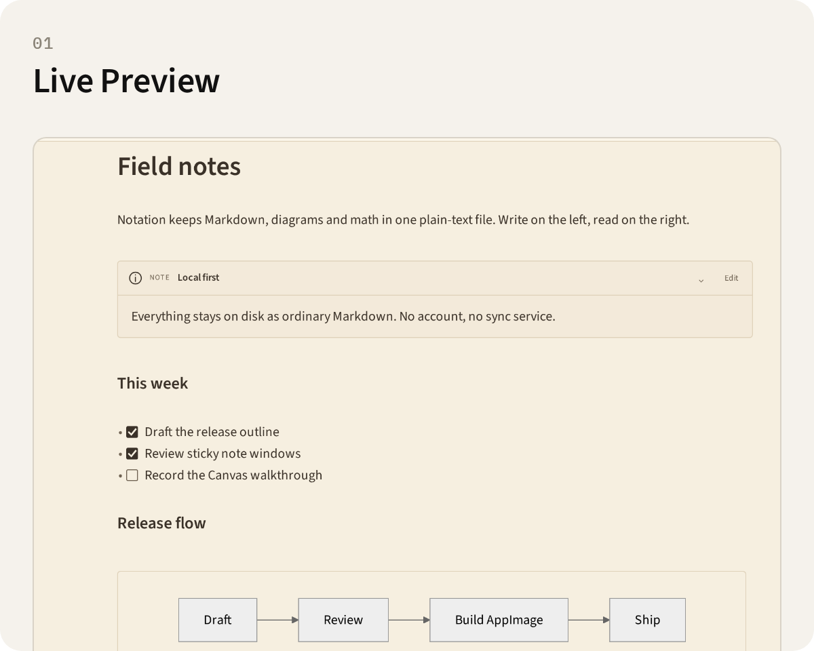
      <p>Markdown renders in place. Syntax comes back only on the line you are editing, and checkboxes toggle with a click.</p>
    </td>
    <td width="50%" valign="top">
      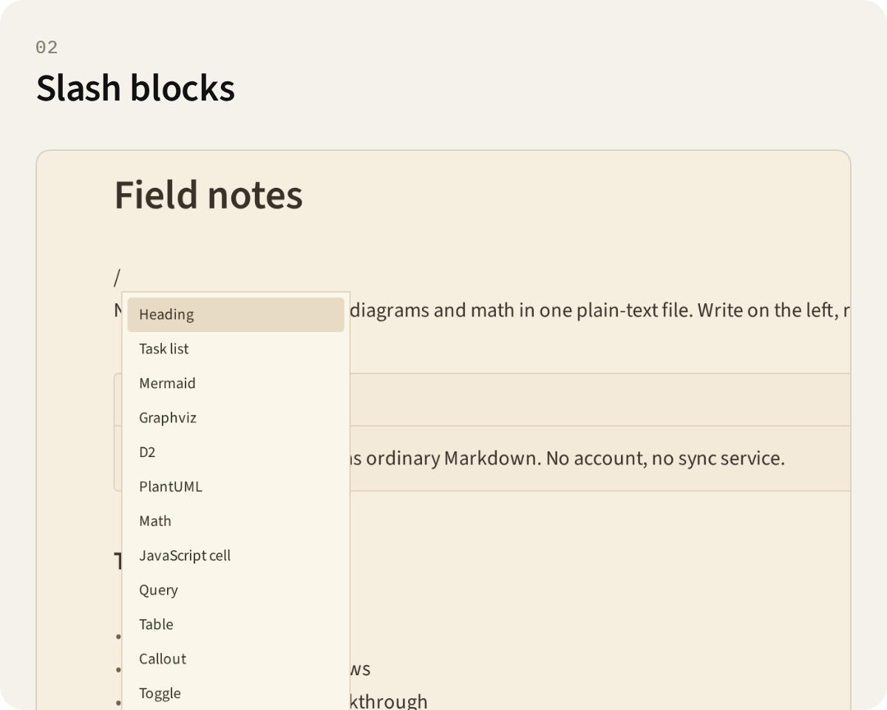
      <p>Type <code>/</code> on a blank line to insert a heading, task, diagram, equation, table, callout, toggle or code block.</p>
    </td>
  </tr>
  <tr>
    <td width="50%" valign="top">
      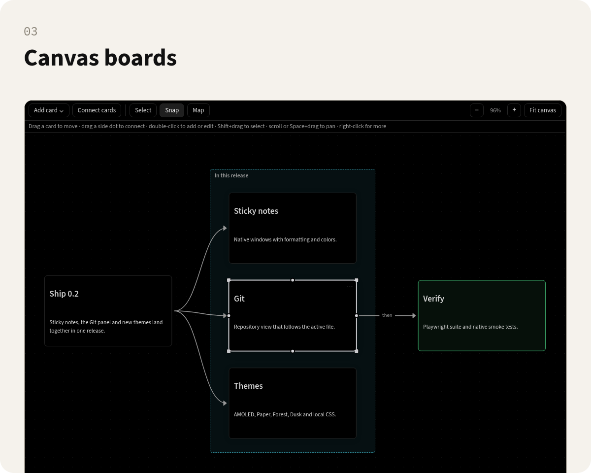
      <p><a href="https://jsoncanvas.org">JSON Canvas</a> boards with cards, labeled connections and links to notes in your workspace.</p>
    </td>
    <td width="50%" valign="top">
      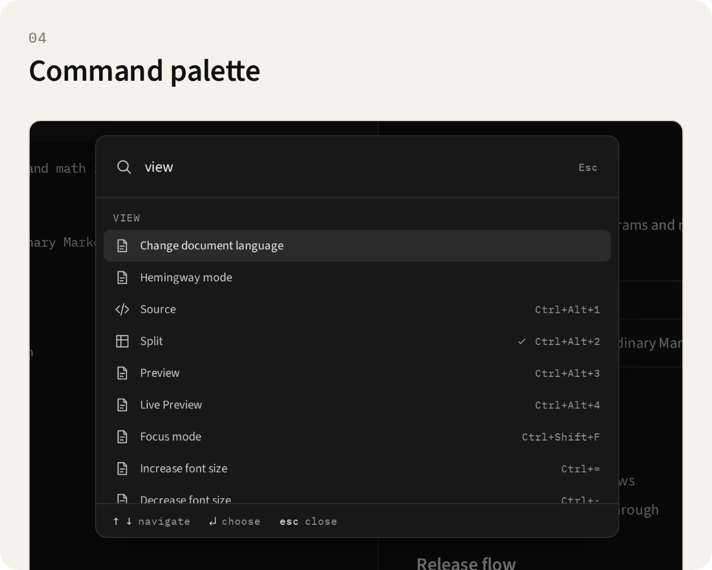
      <p><kbd>Ctrl</kbd>+<kbd>K</kbd> searches every command. Rebind any shortcut in Settings.</p>
    </td>
  </tr>
  <tr>
    <td width="50%" valign="top">
      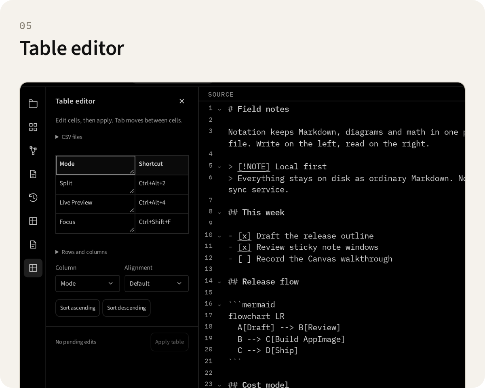
      <p>Edit tables in a grid, sort columns, import CSV, and apply it all as one undoable edit.</p>
    </td>
    <td width="50%" valign="top">
      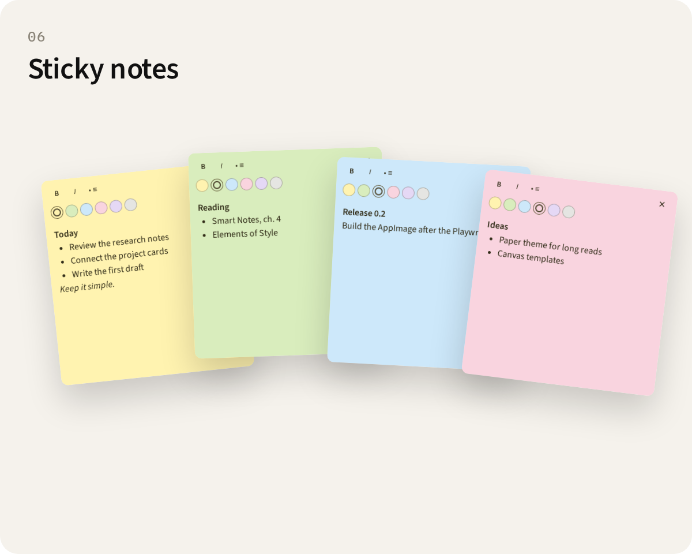
      <p>Native always-on-top sticky windows with bold, italic, bullets and six paper colors.</p>
    </td>
  </tr>
  <tr>
    <td width="50%" valign="top">
      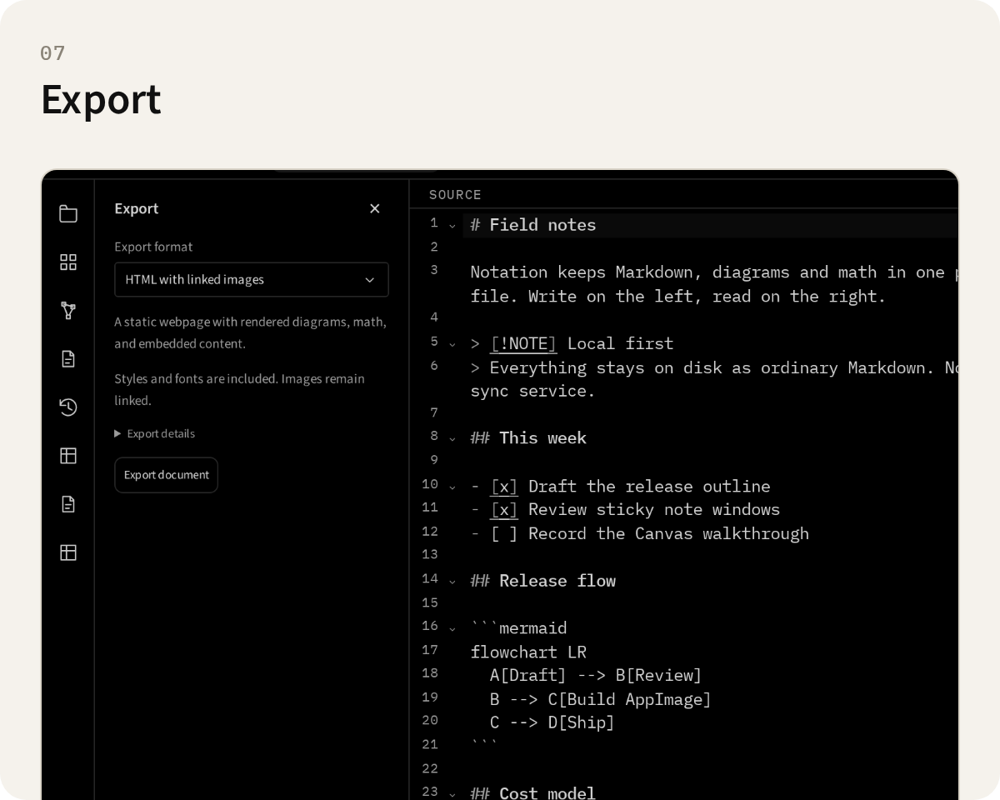
      <p>Export to HTML, a self-contained webpage, PDF, DOCX or slides. Pandoc and Typst ship inside the AppImage.</p>
    </td>
    <td width="50%" valign="top">
      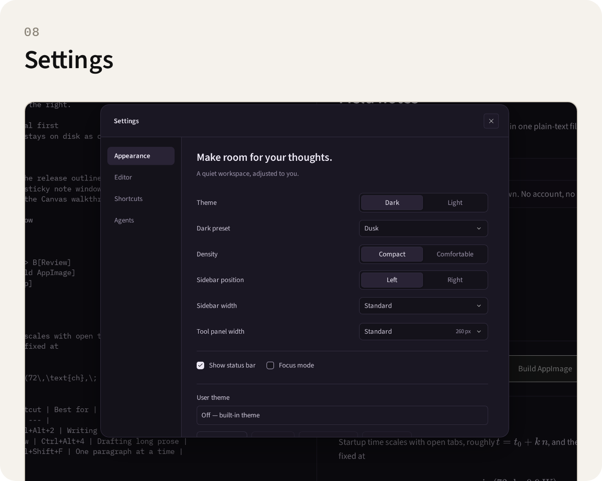
      <p>Themes, density, sidebar layout, editor fonts, shortcuts and agent access, all in one place.</p>
    </td>
  </tr>
</table>

### Seven presets, or your own CSS

Five dark and two light presets ship with the app. Local user themes add your own CSS on top of any preset, with live preview, import and export.

<p align="center">
  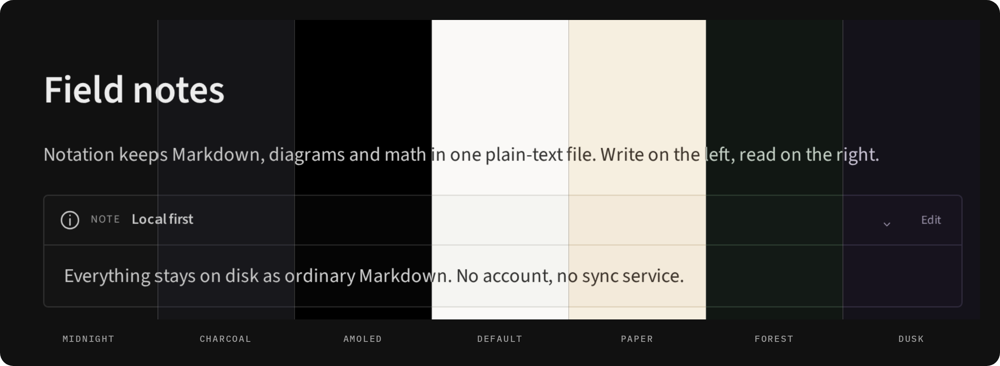
</p>

## Product guide

New to Notation? Read the [user guide](docs/user-guide.md) for a task-oriented tour and [examples](docs/examples.md) for research, Canvas, and theme workflows. Recent additions include the AMOLED, Forest, Dusk, and Paper presets; local user themes with preview, import, and export; Canvas direct resize, connection, and note-linking controls; and Linux sticky notes in separate native windows.

## Desktop application (Linux)

Notation builds into a standalone Linux AppImage with the interface embedded in the executable. It does not need Node.js, Vite, or a browser window at runtime.

After installing the build prerequisites below:

```sh
npm ci
npm run desktop:engines
npm run desktop:build
npm run desktop:install
notation
```

The installer copies the AppImage to `~/.local/opt/notation/Notation.AppImage`, creates `~/.local/bin/notation`, and adds **Notation** to your application launcher. It installs for the current user and needs no sudo. The distributable is in `src-tauri/target/release/bundle/appimage/`.

Rebuild and rerun `npm run desktop:install` to update the installed application. Close the app first. Documents and recovery data are kept outside the installation directory.

Open local text and Markdown files through **Open With → Notation**, or run `notation "notes.txt" "another note.md"`. The installer registers supported text types without changing your default applications. Multiple filenames, spaces, Unicode, and paths relative to the launching directory are supported; use `notation -- --filename.txt` for a name beginning with a dash. Existing canonical paths select their open tab and preserve unsaved edits. Files must be regular UTF-8 text within the 4 MiB editor limit; failures appear in the app.

A running Notation window accepts file requests after restoring its session. The launch acknowledgment means queued, not successfully opened. Requests survive frontend reloads until handled; a closing owner stops accepting new requests and drains accepted work before saving and exiting. A waiting launcher retries the handoff, and can become the next owner after exit. Upgrade and close older releases before relying on file handoff; the older activation-only protocol cannot carry filenames.

On Linux with the NVIDIA kernel module loaded, Notation defaults to WebKit's compatible renderer (`WEBKIT_DISABLE_DMABUF_RENDERER=1`) to avoid the DMA-BUF startup failure observed on this workstation. An explicit environment value is respected. The application still runs as a native Wayland window.

## Development

Use Node.js 22.13+ and a current stable Rust toolchain (Rust 1.89 or newer).

```sh
npm ci
npm run dev
```

Open `http://127.0.0.1:1420`. Browser mode supports importing files and downloading edited documents. It does not silently write back to imported files.

For desktop development or packaging, install the [Tauri system prerequisites](https://tauri.app/start/prerequisites/). Development with hot reload uses:

```sh
npm run desktop
```

On Arch Linux, building Tauri requires `webkit2gtk-4.1` and `gtk3`; `webkitgtk-6.0` is a different API and does not replace that dependency. The AppImage bundles WebKitGTK for runtime use. Desktop mode uses native open/save dialogs and Rust file operations. The desktop Cargo feature is explicit so core file-operation tests can run without GTK/WebKit.

### macOS development

Install these prerequisites once:

- Xcode Command Line Tools: run `xcode-select --install`, complete the installer,
  and confirm `xcrun --find clang` succeeds.
- Node.js **22.13 or newer**, including npm (the Node installer or Homebrew).
- Rust **1.89 or newer**, including Cargo, using [rustup](https://rustup.rs/).
- Python **3.11 or newer** (python.org or `brew install python`); ensure
  `python3 --version` selects it rather than an older Apple-provided Python.

From the checkout, setup and launch require:

```sh
python3 scripts/setup-macos.py
npm run desktop
```

Setup checks the tools and architecture, runs `npm ci`, and prepares a small
disabled-engine resource manifest. It does not download Linux engines or install
optional language servers. The first desktop launch compiles Rust dependencies.
Use native tools consistently: Apple Silicon uses `aarch64-apple-darwin`, Intel
uses `x86_64-apple-darwin`. Python, Node and Rust must agree; mixing Rosetta and
native tools fails preflight. These are separate host builds, not universal binaries.

Setup is repeatable for its own resource stub. If
`src-tauri/resources/engines/` already contains Linux engines, a stub for another
architecture, symlinks, or unknown files, setup/build refuses to replace it.
Move that directory aside yourself and rerun setup. Do not run
`desktop:engines` or `desktop:languages` on macOS: their currently pinned assets
support Linux x86-64 only and their installers reject other hosts before downloads.

Basic editing, Markdown/Mermaid preview, and local file operations are the target.
Pandoc/Typst exports (PDF/DOCX/PowerPoint), native D2/PlantUML rendering,
Pandoc citations, and other native-engine operations remain unavailable: their
Landlock/seccomp sandbox is Linux-only and is never bypassed on macOS. HTML
export and browser-rendered diagrams do not require those executables.
TypeScript/Svelte language intelligence is unavailable; highlighting and code
editing still work. Optional Rust intelligence uses `rust-analyzer` on PATH
(`rustup component add rust-analyzer rustfmt`). Sticky-note windows, dragging, resizing, and always-on-top behavior still need
validation on macOS. Linux single-profile activation/file handoff is unavailable
on macOS. Run one GUI
instance per profile and close it before relaunching. Native scripts remain off
by default; they are trusted code with full user permissions, not sandboxed code.
Their macOS lifecycle is unverified; leave them disabled for initial development.

macOS stores `state.sqlite3` and local app data under
`~/Library/Application Support/local.notation.app/`; `XDG_DATA_HOME` does not
select a macOS profile. Back up this directory with Notation closed.

When ready to test packaging, `npm run desktop:build` (or `desktop:bundle`)
selects `.app` and `.dmg` through `src-tauri/tauri.macos.conf.json`, with output
under `src-tauri/target/release/bundle/macos/` and `bundle/dmg/`. It uses the host
Rust architecture and skips Linux packaging tools. `desktop:install` remains a
Linux AppImage installer; use the macOS app/DMG directly. macOS compilation,
native dialogs, runtime behavior, packaging, signing and notarization have **not
been validated** by a person on a Mac. A macOS CI workflow that builds, ad-hoc signs and launches the app exists but is currently disabled; no Developer ID signed or notarized distribution is provided. See the
[platform audit and validation notes](docs/macos-development.md).

## Editing basics

- Edit Markdown, standalone `.mmd` diagrams, and JSON Canvas boards.
- Preview Mermaid and other diagram fences, Typst and LaTeX math, and note embeds, with localized errors.
- Switch between Source, Split, Preview, and inline Live Preview.
- Choose a Dark or Light mode and preset, a custom local theme, font size, and word wrapping.
- Restore open tabs, drafts, and preferences from local application storage.
- Keep separate desktop sticky notes with autosave and a saved-note list.
- Use workspaces, wiki links, properties, search, note graph, tables, citations, templates, queries, and executable cells.
- Use CodeMirror editing commands, including undo/redo and find.

Press **F2**, double-click a tab, or run **Rename document** to change its name. Use `.mmd` for a standalone diagram, or `.md` for Markdown with fenced `mermaid` blocks. `Ctrl/Cmd+S` saves; `Ctrl/Cmd+Shift+S` opens Save As in desktop mode.

Desktop drafts and preferences use SQLite, with a webview recovery cache. Browser development mode uses local storage. Astro execution and plugins are outside the current product.

## Hemingway mode

Choose **Hemingway mode** through Commands (`Ctrl/Cmd+K`) to write literal, unformatted text in the current tab. Markdown, math in either syntax (Typst or LaTeX), embeds, and canvas JSON remain ordinary source text. The mode preserves the file extension, selection, and previous layout, and recovers separately for each tab.

Typing at an empty caret works. Deletion, selection replacement, cut, drag/drop, undo, and redo are blocked. Copy, navigation, Find, and Save remain available. Script results, revision restoration, formatting commands, and agent edits cannot replace a protected tab. Undo history is retained for after you turn the mode off through the same command.

An IME may revise only its newly inserted, uncommitted composition text; start composition with an empty selection. Once committed, that text is protected too. Composition cannot replace an existing selection. Platform IME behavior has not been verified on every input method.

## Live Preview

Choose **Live Preview** from the compact layout menu, or press `Ctrl/Cmd+Alt+4`, to write and preview in one pane. `#` headings, bold/italic text, inline code, links, list markers, and quotes display their formatting. Markdown syntax reappears on the lines you are editing or selecting.

Mermaid fences become inline diagrams. Click a diagram, or focus it and press Enter, to edit its source; move outside the block or leave the editor to render it again. Invalid diagrams show an editable error in place. For a standalone `.mmd` document, the source is visible while editing and the diagram appears when the editor loses focus.

Switching modes preserves the document, selection, and undo history. Saved files remain ordinary Markdown or Mermaid source. Live Preview omits source line numbers; **Source** and **Split** retain them. The selected mode persists between sessions; **Source**, **Split**, and **Preview** remain available.

## Checkboxes and math

Tasks are clickable in Live Preview and in the rendered preview. A click changes the Markdown marker and can be undone in the editor. Standard task lists, nested tasks, and a bare checkbox at the start of a line are supported:

```md
- [ ] Finish these notes
- [x] Completed task
[] Quick task
```

Typing `[]` followed by a space and a label shows a checkbox in Live Preview. Use Source mode to see all markers. Brackets in code, links, or escaped text remain literal.

Math is written in [Typst](https://typst.app/docs/reference/math/) by default, with LaTeX as the fallback. Write `$x^2 + alpha$` for inline math, or put a display equation between `$$` delimiters:

```typ
$$
1/2 + sum_(i=1)^n i
$$
```

Typst math is rendered by a bundled Typst 0.15 compiler (the same version that produces PDF exports) and the New Computer Modern Math font. It loads the first time a note needs it and never uses the network. Equations take the text colour of the current theme, sit on the text baseline, and scroll sideways when a display equation is wider than the page.

LaTeX keeps working. An equation is read as LaTeX and rendered by bundled KaTeX when it contains a backslash command (`\frac`, `\alpha`, `\begin{…}`), a `\\` line break, a TeX spacing or delimiter escape (`\,` `\;` `\{` `\%`), or brace-grouped scripts (`x^{2}`, `a_{ij}`):

```tex
$$
\frac{1}{2} + \sum_{i=1}^{n} i
$$
```

An equation with none of these markers is tried as Typst first. If Typst rejects it and KaTeX accepts it, as with plain TeX such as `$E = mc^2$` (Typst reads `mc` as one name), KaTeX renders it. Hover an equation to see which engine rendered it and, for a fallback, why.

To choose the engine yourself:

- For one note, add a `math` property: `math: typst` (Typst only, no fallback), `math: latex` (KaTeX only), or `math: auto` (the default behaviour).
- For all notes without that property, set **Settings → Editor → Math syntax** to *Typst, LaTeX fallback* (default), *Typst only* or *LaTeX only*.

Notes written before Typst support render as before wherever they use LaTeX commands. An equation that has no LaTeX marker and is also valid Typst now follows Typst: `$a/b$` is a fraction, `$x^10$` raises `10` (TeX raises only the `1`), and `<=` becomes ≤. Choose *LaTeX only*, or `math: latex` in the note, to keep the old rendering exactly.

Click an equation in Live Preview to edit its source, then leave its line or block to render it again. An invalid equation shows a local math error from the engine that owns it (`Typst: …` or `KaTeX parse error: …`). This is mathematical notation only: neither a Typst document nor a LaTeX document is compiled, and Typst code inside an equation cannot read files, import packages or reach the network. Dollars inside code, escaped dollar signs, and ordinary currency such as `$5 and $10` stay literal.

## Block editing and callouts

Type `/` on a blank line to insert a heading, task, diagram, equation, table, callout, toggle, code fence, or divider. Type to filter; use arrow keys and Enter, or Escape to dismiss. Commands insert ordinary Markdown and can be undone.

**Block actions** operates on the block containing the cursor. Move, duplicate, or delete a whole paragraph, list, fenced block, equation, or callout. Compatible text blocks can become headings, paragraphs, or tasks. These edits preserve source and undo history.

Callouts use Obsidian-compatible blockquote syntax:

```md
> [!NOTE]- Details
> This starts collapsed. Use + to start expanded.
> - [ ] A task inside the callout
```

The disclosure button changes only the view. **Edit callout** exposes its source. Callouts can be nested and contain tasks, math, Mermaid, and wikilinks. Warning, tip, danger, question, and information types use distinct monochrome icons and labels. Unknown types keep their label with the information icon.

## Local scripting

Open **Scripts** to run a JavaScript function body. Scripts are off by default: enable **Settings → Editor → Enable scripts** first. Execution is explicit: opening a note, loading a saved script, or restoring script edits never runs code automatically. The native app embeds QuickJS, so a separate Node.js installation is unnecessary.

```js
console.log(api.context.document.name);
return { text: api.context.document.text.toUpperCase() };
```

A returned string or `{ text }` can be applied with **Apply to document** as one undoable edit. Applying is refused if the document changed since the run began.

Native scripts can use `api.readText(path)`, `api.writeText(path, text)`, `api.listDir(path)`, and `api.run(program, args, { cwd, timeoutMs })`. Relative paths use the chosen working directory, otherwise the document's directory or home. `api.context.document` includes `name`, `path`, `text`, `selection`, `from`, and `to`. Commands receive literal arguments; use `sh` with `-c` explicitly when shell syntax is needed.

```js
api.writeText('summary.md', '# Summary\n\n' + api.context.document.text);
const result = api.run('wc', ['-w', 'summary.md']);
console.log(result.stdout);
```

Scripts run with your filesystem and command permissions. File/system effects happen immediately; editor undo only reverses edits applied inside Notation. Each run has a separate worker process, a 15-second total limit, bounded memory/output, and a **Stop script** control. Browser development mode supports document transforms and logs, and explicitly rejects filesystem/command APIs.

**Save script** adds a named entry to your library. A new script starts as **Not saved to library**, and edits stay separate from your saved library until you choose **Save script**. Restoring script edits replaces the current buffer without running it. Native run history retains the latest 200 runs, including output and errors.

## Workspace and local data

Open **Workspace**, enter a name, and choose **Create workspace**. Use **Add files** to reference existing files from any locations on your machine, or **Add current file** for the saved document you are viewing. A workspace does not create a folder or move your files. The same file can belong to several workspaces. **Referenced files** shows full paths and lets you remove individual references; removing a reference or deleting a workspace leaves files on disk intact.

Switch workspaces using the selector beside your tabs. Each workspace restores its own tabs, selected tab, cursor positions, and layout. A file has one shared editing buffer, so unsaved edits made in one workspace are visible in another. Closing a shared tab only closes that view; deleting a workspace keeps its open tabs in the remaining view. The first workspace keeps your existing tabs.

Search, tags, tasks, links, and graph use the selected workspace’s references. Choose **Refresh index** after external edits. Missing files remain referenced and produce indexing errors. Indexing rejects symlink traversal and oversized files, and stops at 10,000 files or 64 MiB of source. Existing folder workspaces migrate without moving files and keep their folder reference for compatibility.

Your `.md` and `.mmd` files remain authoritative. SQLite holds preferences, recovery drafts, recent files, named scripts, run history, and document revisions. Search and link tables are a separate, rebuildable cache; refreshing them preserves your saved app data.

**History** previews previous versions and shows a unified diff against the current draft or another revision. Choose the comparison and context size; additions and removals are marked with `+` and `-`. Restoring applies an undoable editor change; save explicitly to update the file. History retains up to 50 revisions per document, including saved versions and periodic draft snapshots. It is not a substitute for backups.

The database is `state.sqlite3` in Tauri's application-data directory (`$XDG_DATA_HOME/local.notation.app/`, or `~/.local/share/local.notation.app/` on Linux). The workspace search index is kept beside it in `state.index.sqlite3`; it only caches what your notes contain, is rebuilt when missing, and can be deleted with Notation closed. Existing webview preferences, drafts, and scripts migrate on first startup; the old recovery cache remains available. Failed saves show **Changes not saved**. A restore banner offers only the available work: **Restore tabs**, **Restore document**, or **Restore script edits**; document files stay unchanged, and **Keep current work** dismisses the offer. Back up the application-data directory with Notation closed, alongside your note folders.

On Linux, each canonical application-data profile has one ordinary GUI owner. A second launch asks the existing window to show, unminimize, and request focus, then exits only after that handoff is acknowledged; compositors may still refuse focus. Profiles under separate `XDG_DATA_HOME` values run independently. Crash recovery does not require deleting lock files, and `--mcp`, `--script-worker`, and `--engine-worker` processes bypass GUI ownership.

Profile coordination applies to releases that implement the ownership lock.
Close older releases before upgrading and do not run an older AppImage against
that same profile: old binaries do not honor the lock. Startup refuses a
detectable live legacy MCP endpoint, but cannot exclude legacy processes with
an unavailable endpoint or stop an old binary launched later. Profile paths
must have ancestors protected from replacement by other users; private
directories and sticky system temporary directories are supported.

## Linked notes and properties

Use `[[Note]]`, `[[Note#Heading]]`, or `[[Note#Heading|Label]]`. Type `[[` for note completion and `#` for headings. Click a rendered link, or use Ctrl/Cmd+click or Ctrl/Cmd+Enter in source. Heading navigation uses the opened document, including unsaved headings.

Native resolution checks the current folder first, then unique workspace filenames or YAML aliases. Ambiguous links offer a chooser. Missing notes offer an explicit **Create note** action in the current folder; existing files are never overwritten. Save or create refreshes the index and backlinks. Browser previews can navigate open tabs; workspace lookup and note creation require the desktop app.

Open **Properties** from the command palette to add, change, or delete YAML fields. Text, numbers, booleans, dates, lists, and custom YAML values are supported. Frontmatter begins with `---` on the first line and ends with `---` or `...`. The form preserves comments, unknown fields, and the Markdown body; edits are undoable and require Save to update disk. Dates never change automatically. Invalid YAML remains editable in source. CRLF documents retain their line-ending style; mixed line endings are normalized to one style by the editor.

## Tables and folding

Place the cursor in a Markdown table and run **Table editor** from Ctrl/Cmd+K. Tab and Shift+Tab move between cells. Add/delete rows or columns, set alignment, sort a column, or import CSV, then **Apply table** for one undoable source edit. Export CSV leaves the note unchanged. Quoted CSV fields, commas, quotes, and multiline values are supported; multiline Markdown cells use `<br>`. The grid edits top-level tables; tables inside lists or quotes remain editable in Source. Extra ragged columns produce an error instead of being discarded.

**Fold block**, **Unfold block**, **Fold all**, and **Unfold all** work on headings, code, quotes, and nested lists. Fold state survives Source/Live Preview switches without changing Markdown. Source also has a fold gutter. The command palette includes insertion commands, undo/redo, find/replace, and go to line; the slash menu uses the same insertion templates.

## References, queries, and graph

Add `^block-id` to the end of a paragraph, or on a separate line after a block. Link with `[[Note#^block-id]]`. Embed a note, heading, or block using `![[Note]]`, `![[Note#Heading]]`, or `![[Note#^block-id]]`. Embeds use open drafts when available and otherwise read the source file. Their tasks are read-only; open the source to edit it. **Refresh** reloads an embed. Duplicate block IDs, ambiguous paths, missing targets, cycles, and excessive nesting are reported inline.

Workspace **Search filters** combines content, folder, tags, and typed property conditions. Values can be plain text, JSON strings, numbers, booleans, or arrays. Metadata equality is type-sensitive. Use a property name in **Sort** to order by that field.

A `query` fence renders a read-only database view from saved workspace metadata:

````markdown
```query
view: table
columns: [title, status, priority]
tags: [work]
where:
  - key: status
    op: eq
    value: active
sort:
  by: priority
  direction: desc
limit: 50
```
````

Use `view: list` for a list. Filters support `eq`, `ne`, `gt`, `gte`, `lt`, `lte`, `contains`, and `exists`; filters combine with AND. `tagMode: any` changes tag matching from all to any. Click a result to edit its source note; **Refresh** updates the view. The visible result limit is 200. A `query` fence reads only this workspace index and never executes SQL or JavaScript; to query a real database, use a [SQL block](#sql-blocks).

**Note graph** shows resolved connections and lists unresolved links. It follows the selected tool-panel width preset; drag the graph to pan, use the wheel or +/− to zoom, **Fit** for an overview, and **100%** to return to readable labels. Labels are separated instead of overlapping, and full titles/paths are available on hover and in the Notes list. Tab focuses a note and brings it into view; Enter or Space opens it. Filter by title/path or tag, or switch to the current note's neighborhood. Graph limits and omitted results are shown explicitly.

## SQL blocks

A `sql` fence that names a connection queries a real SQLite, Postgres or MySQL database, read-only, and shows the result as a table:

````markdown
```sql connection:analytics
select id, name, created_at
from customers
where created_at >= :since
order by created_at desc
```
````

The note holds only the connection's name. Host, user, limits and the password live in **Settings → Databases**; a note you share or receive never contains or reveals them. A plain ```` ```sql ```` fence without `connection:` stays an ordinary code block.

**Running.** A block runs only when you press **Run**, or Ctrl/Cmd+Enter in the block or with the cursor inside its fence. Opening, rendering, previewing or exporting a note never runs a query. The first time a note queries a connection in a session, Notation asks in a system dialog that names the connection and shows the query; after that the note can query that connection until you quit. **Cancel** stops a running query on the server. Each block shows when it last ran, how long it took and how many rows came back.

**Results** are kept in memory until you quit; they are not written to the note, to drafts or to settings. Click a column header to sort (again to reverse, a third time for the returned order). `NULL` is shown as such, numbers are right-aligned, and dates, JSON and binary values are shown as text. Values are always displayed as text, never interpreted as HTML or Markdown. **Copy CSV** and **Export CSV** save the result; **Insert as table** adds it below the block as an escaped Markdown table, as one undoable edit.

**Parameters.** `:name` in the query is bound to the note's property `name` as a real query parameter, not pasted into the SQL. Text, numbers, booleans and empty values can be bound. In Postgres, a parameter used as a date or another special type needs a cast such as `:since::text::date`.

**Limits.** Each connection has a row limit (default 1 000, at most 10 000) and a timeout (default 30 s, at most 600 s). A result that is cut says "Showing the first N rows". A single value is shown up to 8 KiB and a whole result up to 8 MiB. Up to four queries run at once.

### Connections and passwords

**Settings → Databases** adds, edits, tests and deletes connections: a name, the kind, and either a SQLite file or host, port, database, user and TLS mode. *Prefer* encrypts when the server offers it, *Require* always encrypts, and *Verify full* also checks the server's certificate and host name against a CA file you choose or the public certificate authorities. Use *Require* or *Verify full* across a network; *Prefer* can be downgraded by someone on the path.

Passwords are stored in the system keychain and nowhere else: not in notes, settings, recovery drafts, logs or exports. Notation never shows a stored password; the form says "stored in keychain" and lets you replace it. Deleting a connection deletes its keychain entry.

- **Linux:** the Secret Service (GNOME Keyring, KWallet or KeePassXC). If the keyring is locked, your desktop asks you to unlock it when a query needs the password.
- **macOS:** your login Keychain.
- **No keychain available:** Notation says why and does not fall back to a file. Choose **Ask every session**: you enter the password once in Settings → Databases, it is kept in memory, and it is gone when you quit. Starting Notation with `NOTATION_KEYCHAIN=off` forces this behaviour.

### Read-only, and why to use a read-only role anyway

SQL blocks cannot change your data:

- **SQLite** files are opened read-only and are never created; only reads and reporting `PRAGMA`s are authorised.
- **Postgres** and **MySQL** run one statement inside a read-only transaction that is always rolled back. A statement the server reports as returning no rows (`CALL`, `DO`, `SET`, any write) is not run at all.
- Obvious writes, schema changes and second statements are refused with a message before anything is sent.

Still **connect with a database role that can only read** what you need. A read-only transaction stops changes to tables, but a powerful role can call server functions with side effects from inside a `SELECT`: ending other sessions, reading server files, taking locks, calling out to other servers. In Postgres, for example:

```sql
create role notes_reader login password '…';
grant connect on database app to notes_reader;
grant usage on schema public to notes_reader;
grant select on all tables in schema public to notes_reader;
```

### Export

HTML, PDF, DOCX and PPTX exports never run a query. A block you ran in this session is exported as its result table with the caption "Results from *connection* at *time*" (the first 1 000 rows, in the order shown); a block you did not run is exported as its SQL. Connection details are never included. Exporting writes only the file you choose; nothing is copied into revision history.

SQL blocks need the desktop app; the browser build shows "Database queries require the desktop app."

### Testing against real servers

`cargo test` covers SQLite and credential handling with no server. `src-tauri/tests/sql-servers.sh start` starts throwaway Postgres and MySQL containers (podman or docker) on `127.0.0.1` with random ports and passwords and writes an `env` file; with it sourced, `cargo test --lib sql` also runs the Postgres and MySQL tests: writes refused for a superuser, TLS modes, timeout and server-side cancel. `src-tauri/tests/sql-servers.sh stop` removes the containers and their data.

## Executable cells, variables, and templates

JavaScript cells opt in with a unique name in the fence:

````markdown
```javascript cell:prices
return { subtotal: 40 };
```

```javascript cell:total
return inputs.prices.subtotal * 1.16;
```
````

**Run cell** uses fresh earlier outputs; **Run through here** explicitly runs preceding cells in order. `inputs` contains named JSON results and `variables` contains frontmatter properties. Cells use the existing synchronous scripting API and desktop file/command access. Opening or rendering a document does not execute code. Stop cancels a run, and edits mark outputs stale. Outputs are session-only; ordinary JavaScript fences and cells in embeds do not execute.

Write `{{status}}` or `{{project.name}}` in Markdown to display a frontmatter value as text. Missing variables remain visible. **Templates** previews and inserts reusable Markdown with these substitutions as one undoable edit. Save templates to the local library, or import/export `.md` templates. `{{document.name}}` is also available during template insertion. The library is bounded to 32 KiB; larger templates can be kept as separate files. Expressions belong in explicit executable cells.

## Media, diagrams, and citations

Use Markdown image syntax or `![[media/file.ext]]` for workspace-local images, audio, video, and PDFs. Local assets are limited to 20 MiB and resolved relative to the note. Add the asset itself as a workspace file reference (choose All files in the picker); referencing a note does not grant access to its whole directory. Migrated folder workspaces retain their existing folder scope. PDFs use the bundled PDF viewer with page controls. Remote images and resources show **Load external media** before making a request. Remote sites can refuse iframe embedding; use their external link to open them separately.

The Linux AppImage bundles GStreamer's playback plugins and plugin scanner. Packaging checks required playback components before publishing an image. On Arch, the build needs `patchelf`, `gstreamer`, `gst-plugins-base`, `gst-plugins-good`, and `gst-libav`; the packaging wrapper stages the scanner from pkg-config's platform-specific path. Damaged media or unsupported codecs show an error beside the player.

Alongside `mermaid`, fenced `dot`/`graphviz`, `d2`, and `plantuml`/`puml` blocks render diagrams. Graphviz runs through bundled WebAssembly. The desktop package includes D2 and PlantUML with its own Java runtime. Renderers have source/output limits and timeouts; diagrams cannot import arbitrary host files or access the network.

Footnotes use `[^note]` and `[^note]: Definition`, with indented continuation paragraphs. Citations use Pandoc-style `[@key]` groups and frontmatter `bibliography`, optional `csl`, or inline CSL `references`. Bibliography/style files must be referenced in the selected workspace, or inside its migrated folder scope. The bundled citation processor formats references in the desktop app; source keys remain in Markdown.

## Canvas and export

**New canvas** creates a separate `.canvas` document using [JSON Canvas 1.0](https://jsoncanvas.org/spec/1.0/). Add and move text, note, media, diagram, and group cards, connect them, and zoom or pan. The board's interaction layer is [Svelte Flow](https://svelteflow.dev) (MIT). File cards use workspace-relative paths. Canvas changes use the same tab recovery, Save, and undo mechanisms as notes. Source mode exposes the JSON, including preserved unknown fields. Save exports the `.canvas` file; rendered canvas conversion is not included.

Drag a card from anywhere on it to move it, and drag the handles of a selected card to resize. Double-click empty space to write a new text card there; double-click a card to edit its Markdown in place (Escape or clicking away keeps the change). The wheel or a two-finger scroll pans (Shift+wheel sideways), pinch or Ctrl/Cmd+wheel zooms around the cursor, and Space+drag or middle-drag pans from anywhere. Shift+drag draws a selection box, also inside a group (the **Select** tool makes that the plain drag), and Shift+click or Ctrl/Cmd+click adds or removes a card; selected cards move together, and a group moves the cards inside it. **Snap** keeps cards on a 20-unit grid; with it off, cards line up with their neighbours when released near an edge or centre. **Map** shows a minimap. Zoomed far out, cards show their title only and get their content back as you zoom in. **Escape** cancels a drag, a resize, a selection box or a connection in progress and puts everything back.

Drag from a dot on a card's side to another card to connect them. Dropping on empty space creates a connected card. A connection leaves from the sides that face each other and follows its cards; a side is recorded in the file only when you pick one other than the automatic choice, or choose **Keep these sides** from the connection's menu. Select a connection to get a grip at each end: drag a grip to another card or side to reconnect it, or drop it on empty space to leave it as it was. Double-click a connection or its label to edit the label. Right-click the board, a card or a connection for more actions, including card colours.

Boards from earlier versions recorded every connection as right-to-left, which can draw arrows around cards. Such a board shows a hint, and **Choose connection sides automatically** (Commands, the board's menu, or the hint) frees every connection in one undoable step. Nothing is rewritten until you ask.

With the board focused, Tab reaches each card and connection. With nothing selected, arrows move focus from card to card (or pan the board); Enter selects the focused card and Enter again edits it. With a selection, arrows move it, Alt+arrows resize it and Shift uses larger steps (a run of arrow presses is one undo step); Ctrl/Cmd+C, V and D copy, paste and duplicate, Delete removes the selection, and Escape clears it. **Connect cards** connects by name with a label. A canvas holds up to 2,000 cards and 8,000 connections, and a change keeps the file's own indentation and line endings.

A blank note card offers **Choose note**. The card details panel opens (also via a card's **⋯** button): search for a note or enter a workspace-relative path, select a result, and **Apply card**. **Open original** then opens the linked note. Desktop searches indexed workspace notes; browser mode resolves open tabs only. Use **Open** or **Add note card / Add media card** for files; dropping a file does not import it.

**Export** captures a note snapshot as HTML, a self-contained webpage, PDF, DOCX, or PowerPoint slides. Rendered diagrams, math, note embeds, and query results are included. HTML includes its stylesheet and fonts; self-contained export also embeds supported local resources and reports any it cannot include. Remote resources are not fetched for export. Exports do not run code cells or change source files. Layout fidelity varies by format; Office/PDF conversions use a light theme.

Math is exported according to its syntax:

| Format | Typst math | LaTeX math |
| --- | --- | --- |
| HTML, self-contained webpage | Embedded as SVG in the page's text colour | KaTeX markup with its fonts embedded |
| PDF | Passed to the Typst engine as written and typeset natively | Converted to Typst by Pandoc |
| DOCX | Converted to a native Office equation by Pandoc; an equation Pandoc cannot convert is embedded as an image | Native Office equation |
| PPTX | Converted to a native Office equation; an equation Pandoc cannot convert is shown as its source text | Native Office equation |

Office equations are Pandoc's translation of the Typst source, so decoration with no Office equivalent (for example `cancel(x)` or coloured text) is dropped, and the export tells you how many equations fell back to an image or to source text. PDF needs no translation and keeps everything.

The Linux x86-64 package bundles Pandoc and Typst, so conversion does not depend on system installations. For a fresh desktop build, run `npm run desktop:engines` first. It downloads pinned, checksum-verified artifacts described in `scripts/engines.lock.json`; generated binaries and licenses live under `src-tauri/resources/engines/`. Engine and font notices ship in the package. Runtime engine resolution does not fall back to PATH.

## Linux sticky notes

Run **New sticky note** from Commands (`Ctrl/Cmd+K`), or open **Sticky notes** in the sidebar. Each note opens in a separate resizable window that requests always-on-top. New notes use true-black AMOLED paper; existing black notes use the same surface, and other notes keep their color. The writing area stays frameless while focused. The compact top bar provides **New sticky note**, **Note options**, and **Close sticky**; drag its empty area to move the window. The options menu offers black, yellow, green, blue, pink, purple, and gray paper and lets you hide the bottom formatting toolbar. Toolbar visibility is remembered on this device.

Write directly on the paper. Formatting supports **Bold** (`Ctrl/Cmd+B`), **Italic** (`Ctrl/Cmd+I`), **Underline** (`Ctrl/Cmd+U`), **Strikethrough** (`Ctrl/Cmd+Shift+X`), and **Bullets** (`Ctrl/Cmd+Shift+8`), including when the toolbar is hidden. Native undo and redo remain available. Text, formatting, and color autosave together to local SQLite independently of Markdown files and regular document drafts. Notes have no visible title or routine save-status text; the first nonempty line supplies their preview in the saved list. Errors remain visible with a retry action. Paste and drop insert plain text only; links, images, arbitrary HTML, and custom styling are not supported.

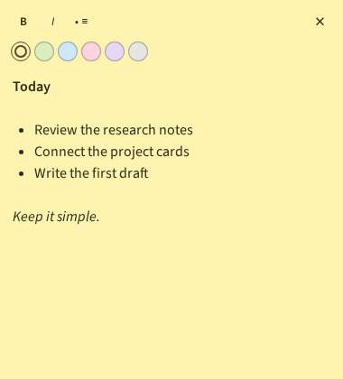

**Close sticky** saves pending edits and keeps the note in the saved list. A save failure leaves the window open with **Retry**. Use **Refresh notes** to update the list and click a saved title to reopen it; reopening an already open note focuses its window. Close a note's window before using **Delete**, which asks for confirmation.

Close sticky windows before exiting Notation, or minimize the main window to keep them visible. The library holds up to 64 notes, with derived titles limited to 256 UTF-8 bytes, text to 64 KiB, and formatting to 128 KiB per note. Older notes keep their literal text: a distinct old title appears as a plain first line, including title-only notes, except the default “Untitled sticky.” Merely opening an older note does not rewrite it. If its combined title/body exceeds a limit, an error asks you to shorten it; the original saved content remains unchanged until a successful edit/save. Sticky windows require the desktop app; browser mode explains this limitation.

Sticky support is merged into `main`. Storage and mocked-window tests passed, but real Linux compositor/window behavior and packaged AppImage verification remain outstanding; see the [audit and verification notes](docs/audits/2026-10-25-usability.md#remaining-verification).

## Tabs, explorer, and settings

The interface uses Notation's original mark and centered custom icons, with a
compact 44-pixel tool rail that can sit on either side. Source Sans 3 is used for the
interface and rendered prose; IBM Plex Mono is used for source, code blocks, and
shortcut hints. Dark and warm light themes share rounded tabs, menus, and
dialogs. New profiles use a 756-pixel reading column; existing reading-width
and editor preferences are preserved. Settings stays within the window, with
scrolling inside its sections rather than moving the surrounding editor.

The interface uses one compact tab row. Press **Ctrl/Cmd+K** or use **Commands** to search actions. The **Notation** menu contains File actions and Settings; the **+** beside the tabs creates a Markdown document. Commands display their current shortcuts; the layout menu stays available at the right edge.

| Default shortcut | Action |
| --- | --- |
| Ctrl/Cmd+K | Commands |
| Ctrl/Cmd+, | Settings |
| Ctrl/Cmd+N / O / S | New / Open / Save |
| F2 | Rename document |
| Ctrl/Cmd+W | Close current tab |
| Ctrl/Cmd+PageUp / PageDown | Previous / next tab |
| Ctrl/Cmd+Shift+E | Explorer |
| Ctrl/Cmd+Shift+G | Git |
| Ctrl/Cmd+Alt+1 / 2 / 3 / 4 | Source / Split / Preview / Live Preview |
| Ctrl/Cmd+Shift+F | Focus mode |

**New** creates a document tab. Opening an already open file selects its tab. Each tab keeps its own draft, cursor, and undo history during the session; closing a tab with unsaved edits asks before discarding it. Open tabs and the selected tab are recovered after restarting. Undo history itself is not restored across restarts.

Open **Explorer** to browse the selected workspace’s referenced files. Full file paths appear on hover and in **Workspace → Referenced files**, including when filenames repeat in different locations. Migrated folder workspaces retain expandable directory browsing; hidden/build directories and symlinks are omitted from those listings.

**AMOLED is the default appearance**, with true-black app surfaces. This update moves the previous Midnight default to AMOLED once; other saved presets, Light mode, and custom themes are preserved. You can select Midnight again after upgrading, and that choice stays saved. **Reset appearance** also returns to AMOLED.

**Settings → Appearance** controls the built-in Dark or Light mode, its preset (Dark: Midnight, Charcoal, AMOLED, Forest, Dusk; Light: Default, Paper), local user themes, interface density, sidebar position and width presets, status bar, and focus mode. Theme, density, and position use segmented controls; Compact and Comfortable change interface spacing and control sizes. Sidebar width changes the narrow icon strip with Narrow, Standard, and Wide presets. Tool panel width separately sizes the open tool beside it, including Note graph; an existing custom panel width is preserved until a panel preset is chosen. Both settings are saved across restarts. The app sidebar opens Explorer, Workspace, Note graph, Sticky notes, Git, History, Properties, Templates, Table editor, and Scripts. Settings and Export live in the Notation menu, and Git has a distinct branch icon. Choose **Sidebar position → Left / Right** to move the navigation and its open tool together. The side is saved across restarts. Click the selected tool again to close it, or use Focus mode to hide the sidebar. In narrow windows, the tool overlays the editor to preserve writing width. Arrow Up/Down and Home/End navigate the sidebar buttons. **Editor** controls font family/size (bundled Source Sans 3 and IBM Plex Mono), line height, reading width, wrapping, layout, line numbers, and smooth scrolling. It also has the opt-in **Enable scripts** toggle, which is off by default and shows the Scripts panel and command; saved scripts, drafts, and recovery offers are retained while it is off. Smooth scrolling eases mouse-wheel steps, including small and fractional high-resolution mouse input, in documents and panels; turn it off for immediate native scrolling. System reduced-motion preferences disable the animation. If animation misses its frame budget, the rest of that wheel gesture switches to immediate scrolling instead of accumulating delays. The Editor section includes custom number steppers and a live typography/layout specimen. Each section has its own reset; these resets preserve documents, scripts, and recovery data.

For custom CSS, choose **Create theme** in **Settings → Appearance**, select a **Built-in base**, then **Preview theme** and **Save and apply theme**. You can select, edit, duplicate, delete, import, or export local themes. **Ctrl/Cmd+Shift+F12** disables custom styling without deleting saved themes. See the [theme guide](docs/user-guide.md#themes) and [CSS/JSON example](docs/examples.md#a-small-local-theme) for supported syntax and limits.

Settings keeps the same window-relative size across sections. Long sections scroll inside the dialog; the Shortcuts list scrolls independently while its search and close controls stay visible.

**Settings → Shortcuts** lets you search by command or group, record or type bindings, disable a command's shortcut, and restore defaults. Conflicting bindings are rejected, and clipboard/undo shortcuts stay available to the editor. The command menu remains accessible even if its shortcut is disabled. Your window manager's global shortcuts take precedence over application bindings.

**Git** appears only in the desktop app when the active saved file exists in a Git worktree and Git is installed. It follows the file's actual path, not the selected workspace, and shows that repository's root, branch, changed files, commit graph, and diffs (including linked worktrees). Switching to an untitled, missing, or non-repository file hides Git and closes its panel; the shortcut and command are unavailable too. These views read local repository state; they do not stage, commit, fetch, or push. Save editor changes to include them in Git's working-tree diff. Legacy native/MCP Git queries still use the selected folder workspace's scope.

## Agent MCP connection

Keep the desktop app open and configure an MCP client to launch `notation --mcp`. For clients using an `mcpServers` configuration:

```json
{
  "mcpServers": {
    "notation": {
      "command": "notation",
      "args": ["--mcp"]
    }
  }
}
```

If `notation` is not on that client's PATH, use the absolute path to `~/.local/bin/notation`. The adapter communicates over [MCP stdio](https://modelcontextprotocol.io/specification/2025-11-25/basic/transports) and connects to the desktop app through a private local socket. It does not start a second editor window.

**Settings → Agents → MCP for agents** shows a copyable command with the socket path for the running instance. Use that path with `--socket` when the client uses a different data-directory environment. Both the `2025-11-25` initialization handshake and the `2026-07-28` per-request protocol are supported.

Agents can browse/search the selected workspace, inspect Git, list tabs, read current unsaved text, open documents, and apply guarded edits. Edits require the exact content the agent previously read; stale edits fail. Successful edits become one undoable editor change and do not automatically save the file. Disable agent editing in **Settings** to retain read access. No shell-execution tool is exposed through MCP; the separate Scripts panel remains available for explicit local automation.

Available tools: `workspace_info`, `list_directory`, `search_documents`, `read_file`, `list_tabs`, `read_tab`, `open_document`, `edit_document`, `git_status`, `git_history`, and `git_diff`. Read/edit text is limited to 4 MiB per document. `read_file` reads disk; `read_tab` reads the live editor buffer. Opening a document preserves other dirty tabs, and editing an inactive tab does not change the selected tab.

## Validation

```sh
npm run check
npm run test:store
npm run test:preferences
npm run test:documents
npm run test:markdown
npm run test:math
npm run test:tables
npm run test:canvas
npm run test:workspace
npm run test:export
npm run test:citations
npm run test:hemingway
npm run test:sql
npm run build
npx playwright install chromium
npm run test:e2e
cargo test --locked --manifest-path src-tauri/Cargo.toml --no-default-features
cargo fmt --manifest-path src-tauri/Cargo.toml -- --check
cargo clippy --locked --manifest-path src-tauri/Cargo.toml --no-default-features --all-targets -- -D warnings
python3 tests/native/packaging_test.py
```

Playwright starts an isolated Vite server on port 1420, so stop any existing development server before running tests. Tests exercise real CodeMirror input, rendering, malformed diagrams, browser import/export, draft recovery, preferences, layouts, and HTML sanitization. Live Preview tests also cover source preservation, undo across modes, inline diagram editing, keyboard access, standalone Mermaid, task toggles, and math rendering with local fonts. Failed tests retain screenshots and traces; use `npx playwright show-report` to inspect results.

Rust tests exercise real temporary files. Browser tests do not exercise native operating-system dialogs or prove desktop-webview compatibility. Validation runs locally. A macOS workflow (`.github/workflows/macos.yml`) that builds and launches the app and runs this suite on WebKit exists but is disabled and manual-only. The Python packaging tests verify playback dependencies and portable build helpers without building or launching the app.

The installed Linux package has an additional native smoke test using `tauri-driver` and `WebKitWebDriver`, with temporary user-data directories:

```sh
cargo install tauri-driver --locked
python3 tests/native/smoke.py --app "$HOME/.local/bin/notation"
python3 tests/native/sqlite_smoke.py --app "$HOME/.local/bin/notation"
python3 tests/native/knowledge_smoke.py --app "$HOME/.local/bin/notation"
python3 tests/native/advanced_smoke.py --app "$HOME/.local/bin/notation"
python3 tests/native/tooling_smoke.py --app "$HOME/.local/bin/notation"
python3 tests/native/close_smoke.py --app "$HOME/.local/bin/notation"
python3 tests/native/instance_smoke.py --app "$HOME/.local/bin/notation" --check-windows
python3 tests/native/file_launch_smoke.py --app "$HOME/.local/bin/notation"
python3 tests/native/file_launch_ui_smoke.py --app "$HOME/.local/bin/notation"
python3 tests/native/sidebar_width_smoke.py --app "$HOME/.local/bin/notation"
python3 tests/native/checkbox_smoke.py --app "$HOME/.local/bin/notation"
python3 tests/native/hemingway_smoke.py --app "$HOME/.local/bin/notation"
```

These checks cover the embedded application, rendering, block editing, scripting, real file operations, SQLite persistence, and workspace indexing in isolated temporary profiles. The knowledge smoke adds note resolution and explicit creation, backlinks, CRLF properties, and revision comparison/restoration. `TAURI_DRIVER` and `WEBKIT_WEBDRIVER` can override driver locations. A graphical desktop session is required; no Vite server is started.

The advanced export smoke uses Python PyGObject and the AT-SPI typelib to operate the real GTK save dialog. It matches the app's isolated data directory before sending input and does not replace the Tauri bridge or clipboard.

The close smoke additionally requires Hyprland's Lua dispatcher. It sends the same close request as Super+Q to a verified test-owned window and checks that the window actually disappears before cleanup.

The instance smoke uses disposable profiles and MCP without WebDriver to check launch handoff, concurrent starts, profile aliases, worker modes, paused-owner refusal, and crash-during-handoff recovery. `--check-windows` requires Hyprland and checks that a paused owner does not produce a secondary window. `--check-focus` also requires focus transfer, so it needs compositor activation permission (for example, Hyprland `misc:focus_on_activate=true`). Omit these flags on other desktops; their checks are then explicitly unrun. An optional `--legacy-app /path/to/older.AppImage` checks refusal while a detectable older release owns the profile.

The file-launch checks exercise actual CLI and desktop-entry opening, text MIME routing in a disposable home, startup races, unsaved buffers, visible errors, and close-time handoff. The sidebar-width check measures the packaged icon strip and tool panels, including migrated native preferences and restart persistence. `python3 tests/native/desktop_exec_roundtrip_test.py` separately verifies generated Exec arguments through GIO.

## Layout

- `src/`: Svelte workspace, editor integration, and preview rendering.
- `src-tauri/`: Rust file operations, Tauri commands, desktop configuration, and Rust tests.
- `tests/e2e/`: Playwright user-workflow tests.
- `playwright.config.ts`: browser and development-server configuration.

Build frontend assets with `npm run build`; build the desktop application with `npm run desktop:build` once native prerequisites are installed.

### Code editing and language intelligence

Text and code files open in source mode without changing a workspace's Markdown
preview layout. Notation preserves code extensions and extensionless filenames.
New notes default to Markdown. Files choose their editor from the filename: Markdown
keeps the selected writing layout, while text and code files use Source. Click the
small language label in the status bar, or run **Change document language** from
Commands, to override a document. The override is saved with its session; choose
Automatic to return to filename detection. Syntax support
covers JavaScript/TypeScript/JSX/TSX, Svelte, Rust, JSON, HTML, CSS, Python, and YAML.
Code mode provides bracket matching, automatic bracket closing, indentation,
line comments, and syntax-aware folding. Settings → Editor controls indent size,
tabs versus spaces, and language intelligence.

Language intelligence is **off by default**, including upgrades from the earlier
default-on release. Syntax highlighting, folding, comments, and indentation work
without language servers. The intelligence client loads only when enabled for a
supported saved file; Markdown sessions do not load code-language grammars.

To opt in, first install the optional tools, then enable **Settings → Editor →
Language intelligence**. Saved TypeScript/JavaScript, Svelte, and Rust files can
then use completion, hover, signature help, diagnostics, definition/reference
navigation, symbol rename, and formatting.

The Linux AppImage does **not** include Node or TypeScript/Svelte language servers.
From the source checkout, explicitly run `npm run desktop:languages` to download
and install the pinned TypeScript/Svelte language pack. It lives under
`$XDG_DATA_HOME/local.notation.app/language-servers` (normally
`~/.local/share/local.notation.app/language-servers`), separately from the app.
For Rust, install `rust-analyzer` and `rustfmt` using your Rust toolchain.
No language tools are downloaded by opening documents, enabling the setting,
or building the default app.
Missing servers and initialization failures appear beside the Language menu.
Servers start on demand, are shared by canonical project root and server kind,
and stop after their last document closes. At most six servers run per app
process. Workspace references can span different project roots.

| Command | Default shortcut |
| --- | --- |
| Go to file | Ctrl/Cmd+P |
| Search workspace files | Ctrl/Cmd+Alt+J |
| Go to definition | F12 |
| Find references | Shift+F12 |
| Rename symbol | Ctrl/Cmd+Alt+R |
| Format document | Ctrl/Cmd+Shift+I |
| Toggle line comment | Ctrl/Cmd+Alt+/ |

Go to file and workspace search cover open tabs and the active workspace's
explicit file references. Search uses current unsaved buffers when available,
performs a case-insensitive literal search on demand, and reports truncation
(500 files, 16 MiB of text, or 200 matches). It does not crawl unrelated folders.

Rename opens affected files as unsaved, undoable buffers. It validates all
ranges before applying changes, rejects file operations and targets outside the
server's root, and limits one rename to 32 files. Save each changed file when
ready. Formatting and rename reject edits when their source buffer changed
while the request was running. Ordinary saves compare the disk contents with
the saved baseline and reject stale overwrites. Tab changes and window focus
check for external edits; Compare / reload lets you inspect the difference,
keep editing, or explicitly replace the buffer. Save As can preserve a separate
copy. The disk comparison is not an operating-system lock on other editors.

**Settings → Editor → Automatically reload external changes** follows edits
made by other tools or agents to the file currently displayed in the desktop
app. It is off by default. When enabled, a clean file and its preview refresh
automatically within a few seconds, including while Notation stays focused.
Unsaved edits, renamed buffers, and Hemingway mode keep their content and offer
the existing conflict controls instead. Missing or temporarily unavailable files
keep their displayed content; checking resumes when the file becomes available.
Other tabs are checked when selected. This setting does not refresh workspace
search indexes; use **Refresh index** for those.

Language servers run locally. Svelte project configuration/preprocessors are
not executed automatically. The optional Svelte pack bypasses project Prettier
configuration and plugins through pinned patches. Rust build scripts, procedural
macros, and automatic Cargo checks are disabled. This limits features that depend on those
project hooks. Language intelligence is not a terminal, debugger, build-task
runner, or full Git client. File size and tab limits remain 4 MiB and 64 tabs.

The optional installer uses a separate lockfile under `tooling/language-servers/`,
disables npm lifecycle scripts, and verifies a checksum-pinned Node binary.
Generated packs are ignored by git and excluded from default AppImage packaging.
No CI service is required.

For a disposable packaged stress run, use:

```sh
python3 tests/native/lightweight_stress.py --app /path/to/Notation.AppImage --output /tmp/notation-stress
python3 tests/native/instance_smoke.py --app /path/to/Notation.AppImage --output /tmp/notation-instances
```

The first run measures 64 mixed tabs, a 60,000-line code file, large Markdown
preview, near-limit text, repeated tab cycles, and idle CPU/RSS/PSS while asserting
that no language servers start. The second checks single-profile ownership,
concurrent launches, separate profiles, and recovery. They use disposable state;
measurements include WebKit and remain machine- and workload-dependent.

### Performance mode and memory

Enable **Settings → Editor → Performance mode** for source-only editing without
syntax parsing, language intelligence or smooth scrolling. Your usual settings
and undo history are preserved. It is off by default. In normal mode, inactive
editor views are released unless language intelligence is explicitly enabled.
See [memory retention and disk caching](docs/memory-retention.md) for what stays
in RAM, cache limits and verification commands. The
[measured performance report](docs/performance-report.md) includes packaged-app
stress results, language-server costs and remaining optimization targets.

### Automatic reduced formatting

Normal mode temporarily uses **Source** for a large or punctuation-heavy Markdown
note. A notice above the editor explains the change. Syntax highlighting, folding,
inline widgets and rendered preview pause for that document; text, selection,
undo/redo and saving remain available. Smaller notes still use their chosen layout.
When the document shrinks enough, its chosen layout and rich formatting return.
Previously collapsed editor blocks return expanded after this transition.
This does not enable the global Performance mode or change its other settings.

The guard runs before parsing a changed editor state. It uses conservative
thresholds measured in UTF-16 code units: 256 Ki units for size, or at least
64 Ki units with 35% Markdown punctuation or a run of 256 identical delimiters.
Restoration uses lower thresholds (below 192 Ki units, under 28% punctuation and
runs shorter than 192; notes below 48 Ki units always restore). This prevents
formatting from repeatedly toggling while typing at a boundary. These heuristics
are not a universal latency guarantee; unusually costly smaller notes can still
benefit from Performance mode. Emoji and other Unicode text are preserved.
See the [responsiveness measurements and remaining limits](docs/markdown-responsiveness-20261030.md).

## Project agents and contribution workflow

Start the sandboxed Astra session with `scripts/notation-advisor`. Work starts
with a scoped GitHub issue assigned to the owner, uses an issue branch and
linked PR, and receives local checks plus GLM Flash challenger review. The
macOS build workflow exists but is disabled and manual-only. See [the project orchestration guide](orchestration/README.md)
for prerequisites, model routing, sandbox limits and issue-to-merge commands.

## Brand

The wordmark uses an optically spaced lowercase `notation` with a cut first `n`; the standalone mark is the solid `n`. Use them in black or white on black, near-black (`#111111`) or cream (`#F5F2EC`). Do not recolor, outline or stretch them.

<table>
  <tr>
    <td width="60%" align="center">
      <picture>
        <source media="(prefers-color-scheme: dark)" srcset="docs/readme/brand/notation-wordmark-dark.svg">
        
      </picture>
    </td>
    <td width="40%" align="center">
      <picture>
        <source media="(prefers-color-scheme: dark)" srcset="docs/readme/brand/notation-mark-dark.svg">
        
      </picture>
    </td>
  </tr>
  <tr>
    <td align="center"><a href="docs/readme/brand/notation-wordmark-light.svg">Wordmark, dark ink</a> &middot; <a href="docs/readme/brand/notation-wordmark-dark.svg">white</a></td>
    <td align="center"><a href="docs/readme/brand/notation-mark-light.svg">Mark, dark ink</a> &middot; <a href="docs/readme/brand/notation-mark-dark.svg">white</a></td>
  </tr>
</table>

<p align="center">
  
</p>
