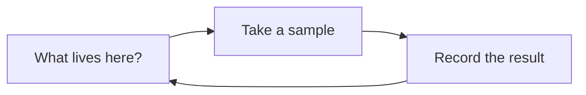

# Notation examples

Two practical workflows and a local theme. See the [user guide](user-guide.md)
for the full feature tour and the [README](../README.md) for setup.

## A research note with sources and a diagram

Save this as `field-notes.md` inside a workspace. The outer four-backtick fence
shows the file exactly; the Mermaid block uses normal triple backticks.

````markdown
---
title: Tidepool field notes
tags: [research, ecology]
references:
  - id: doe2024
    type: book
    title: Field Methods
    author:
      - family: Doe
        given: Jane
    issued:
      date-parts: [[2024]]
---

# Tidepool field notes

Two related notes: [[species-list|Species list]] and [[methods#Sampling|sampling method]].

Estimate the pool volume with $V = \pi r^2 h$. The observation [@doe2024] matches
the earlier survey.



> [!NOTE] Keep the source
> Save the `.md` file; the diagram remains an editable fenced block.

- [ ] Add the next sample
- [x] Record the site
````

Add the file to the workspace and open it in **Split** or **Live Preview**. Click
`[[species-list|Species list]]`; on desktop, **Note not found** offers **Create note** in the
current folder. Desktop formats `[@doe2024]` into a citation and Bibliography;
browser preview keeps the key visible and reports that formatting needs desktop.
In Live Preview, click the diagram to edit its Mermaid source, then move away to
render it again. **Save** writes the Markdown file; recovery drafts and History
are not saved files.

## From notes to a Canvas planning board

Start with three notes in a workspace: `field-notes.md`, `species-list.md`, and
`methods.md`.

1. Run **New canvas**, then save the board as `planning.canvas`.
2. Choose **Add card → Add note card** twice. For each blank card, use **Choose
   note**, **Find note**, **Search notes**, select a **Use note: …** result, then
   **Apply card**. **Open original** opens the note at its saved heading.
3. Add a **text card** for the open question and an **Add group** around related
   cards. Use **Add diagram card** for a small Mermaid sketch.
4. Connect the question card to each note with the card's `⇢` button, or use
   **Connect cards** and **Add connection**.
5. Drag titles to arrange, drag a bottom-right corner to resize, and use
   Space+drag or middle-drag to pan. **Fit canvas** frames everything.
6. **Save** writes the `.canvas` file. A recovery draft alone does not.

Note cards store workspace-relative paths such as `notes/field-notes.md`. On
desktop, **Create note** can make a missing target explicitly. Browser note cards
resolve open tabs only. JSON Canvas `link` cards can be imported or edited in
Source, but the **Add card** menu has no link entry.

## A small local theme

Open **Settings → Appearance**, choose **Create theme**, name it `Ocean`, set
**Built-in base** to `dark/dusk`, and paste:

```css
:root {
  --bg: #102a33;
  --bar: #163a45;
  --panel: #14323c;
  --text: #e6f4f1;
  --accent: #8fd3ff;
  --border: #2a5460;
}
.workspace-bar {
  color: var(--accent);
}
```

Use **Preview theme** to try it, then **Save and apply theme**. Select it from
**User theme**; choose **Off — built-in theme** to return to the preset. The same
theme as a version 1 import file:

```json
{
  "version": 1,
  "id": "theme-ocean",
  "name": "Ocean",
  "base": "dark/dusk",
  "css": ":root {\n  --bg: #102a33;\n  --bar: #163a45;\n  --panel: #14323c;\n  --text: #e6f4f1;\n  --accent: #8fd3ff;\n  --border: #2a5460;\n}\n.workspace-bar {\n  color: var(--accent);\n}\n"
}
```

The `css` value is a JSON string, so breaks are written as `\n`. Import validates
the format and assigns a fresh local ID. If a theme hides the UI, press
**Ctrl/Cmd+Shift+F12**; it always disables custom styling and keeps saved themes.
