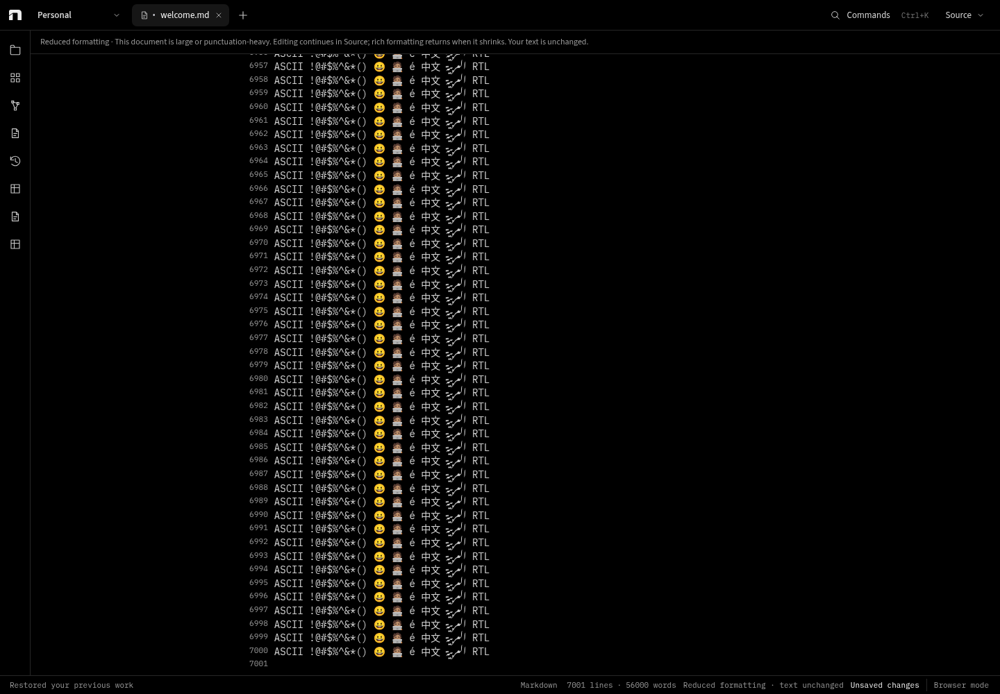

# Markdown responsiveness — 2026-10-30

Issue: [#52](https://github.com/esshi1337/notation/issues/52). Base: upstream main `0da93fe8498484b6543da466dbc213baa131a4b2`, verified current before implementation and final review. Measurements use synthetic documents in isolated browser profiles; the installed application and user checkout were not changed.

## What changed

Folding now retains the established block grammar without resolving inline delimiters, deduplicates ranges linearly, and caches ranges and header lookups per immutable document. Live Preview reuses document analysis when only selection, focus or fold visibility changes. Edited versions still require full analysis; this is not incremental or viewport-only rendering.

Large or punctuation-heavy Markdown notes automatically use Source with reduced formatting. The guard runs before constructing the changed editor state, removing Markdown language and presentation extensions before expensive parsing starts. A visible notice explains the change. Source text, selection, undo and the chosen layout are preserved; rich formatting returns after the document shrinks. The setting affects the individual document and is independent of global Performance mode.

Entry thresholds are 256 Ki UTF-16 code units, or at least 64 Ki units with 35% significant Markdown punctuation or 256 identical consecutive delimiters. Once reduced, a note restores below 192 Ki units when punctuation is under 28% and delimiter runs are shorter than 192; below 48 Ki units it always restores. These different entry/restoration thresholds prevent repeated toggling at a boundary. They are heuristics, not a universal latency guarantee.

## Production browser measurements

The same production-build harness and fixtures ran against the base and changed code. Edit values below are medians of five keys; paste values are individual operations. Timing includes browser automation and two animation frames, with roughly a 33 ms floor. The main matrix included 24 pastes, 100 edits, 16 file opens and 16 tab switches. These are local observations, not guaranteed native desktop latencies.

| Scenario | Before | After |
| --- | ---: | ---: |
| 512 KiB punctuation, Source paste | 1,111 ms | 42 ms |
| 512 KiB punctuation, Source edit | 1,078 ms | 33 ms |
| 1.5 MiB punctuation, Source paste | 11,919 ms | 72 ms |
| 1.5 MiB punctuation, Source edit | 7,790 ms | 50 ms |
| 1.5 MiB Unicode, Source edit | 365 ms | 50 ms |
| 512 KiB structured Markdown, Live edit | 2,067 ms | 33 ms, reduced Source |
| 128 KiB structured Markdown, Live edit | 283 ms | 333 ms, still rich |
| Eight 512 KiB notes, tab-switch median | 300 ms | 100 ms |

The large Live result deliberately trades rich presentation for responsiveness. Tab-switch timings have an automation click floor near 100 ms. The medium Live case remains slow: a separate alternating-order comparison with three fresh contexts per version and 15 samples per operation measured cursor movement at **216 → 67 ms median**, and edits at **367 → 350 ms median**. Edit ranges overlapped (300–383 ms both versions); these runs do not establish a meaningful medium-document typing improvement or a consistent regression. Further incremental analysis/decorations work is needed.

A separate three-run Node folding benchmark on 512 KiB fixtures measured median uncached times: punctuation 390 → 8 ms, prose 23 → 6 ms, paragraphs 44 → 17 ms, Unicode 12 → 4 ms, headings 523 → 62 ms. The heading fixture retained all 23,831 fold ranges. This measures folding, not end-to-end UI latency.

## Integrity and diagnostics

- Clipboard coverage includes ASCII punctuation, emoji, ZWJ sequences, CJK, combining marks, bidirectional controls and NUL. Valid text matched exactly. Browser clipboard normalization changed deliberately invalid unpaired surrogates before the editor received them; the editor matched the resulting clipboard value.
- Copying 128 KiB Unicode from one editor and pasting into another preserved the source (55 ms). A 518,000-byte / 336,000-unit synthetic Unicode note survived browser reload exactly; its preferred Live layout persisted while reduced Source was displayed.
- The 4 MiB boundary accepted valid ASCII and emoji fixtures in Performance mode with wrapping off. Oversized input was rejected while preserving the previous text. File import intentionally rejects NUL as binary; clipboard and external editor updates separately cover NUL.
- The main matrix reported no uncaught page or harness errors. It recorded 22 long tasks, maximum 313 ms, with the longest tasks in the medium Live case.
- It also recorded **114 caught browser recovery-cache quota errors**, unchanged from the baseline, beginning with the fifth 512 KiB tab. This batch does not fix recovery-cache serialization/quota churn or establish reliable reload of an oversized multi-tab workspace.

Earlier profiling implicated frontend Markdown work in the reproduced stalls. Healthy native storage timings and separately injected SQLite contention were measured in the original diagnostic, not rerun by this frontend batch. No Rust, store or IPC production code changed; backend lock handling remains separate work.

## Validation and independent review

Final frozen-source Playwright run: **319 passed**, 2.8 minutes. Production build passed; Svelte/TypeScript check reported zero errors and warnings. Fixed sandbox suites passed: tables (11), Markdown (11), store (18 groups including 9 comparisons), citations (4), export (5), documents (8), preferences (35), workspace (9), canvas (7), Hemingway (7), and code editor. The build retains its existing large-chunk warning.

Independent GLM challenger review found no blockers and independently passed tables, Markdown, check and Hemingway. Review covered threshold transitions, rejected changes, inactive editor updates, hysteresis, grammar preservation and preview cleanup. Remaining optional findings are duplicate classification scans for medium notes, full per-edit Live analysis and loss of collapsed editor fold state after a rich → reduced → rich transition. App-level fold preferences survive, but editor blocks return expanded. WeakMap caches permit garbage collection when document versions become unreachable; runtime lifecycle/memory instrumentation was not performed, so this report makes no leak-freedom or hard-memory-budget claim.

Test setup repairs keep Vite caches under the existing sandbox-writable `node_modules/.vite` mount, resolve Hemingway helper imports through Vite SSR, wait for application initialization in the inactive-editor fixture, and align the stale identity assertion with the already-shipped AMOLED default. The sandbox policy and behavioral protection assertions were not weakened.

Two earlier full browser attempts each passed 315/319. Failures included test selectors/fixtures, initialization timing, a stale then interim incorrect theme expectation, and three missing sticky-test disposal hooks during a run with source edits. The final run used frozen source and passed all sticky tests without product sticky changes. The proposed source-edit/HMR explanation for the missing hooks is not a proven root cause.

## Remaining release and performance gaps

Native GUI startup is blocked by the environment's ancestor-directory ownership check. That security check was not bypassed. Native WebKit/Tauri interaction, packaging and installation are **unverified** for this batch; browser success is not native acceptance.

Wrapping, very long lines, manual commands, export, decoration rebuilding and persistence can still be expensive. Medium rich notes still show hundreds of milliseconds of latency. Large-note formatting reduction also resets collapsed editor folds. No persistent monitoring service was installed; the stress harness collected diagnostics during these runs.

Local raw evidence is retained at `/home/esshi/Coding/notation-diagnostics/20261030/fix-validation`: browser/extra/limit summaries, metrics, reload check, folding benchmarks, alternating medium comparison, final check logs and the independent review. This directory is an author-machine artifact, not bundled with the app.
